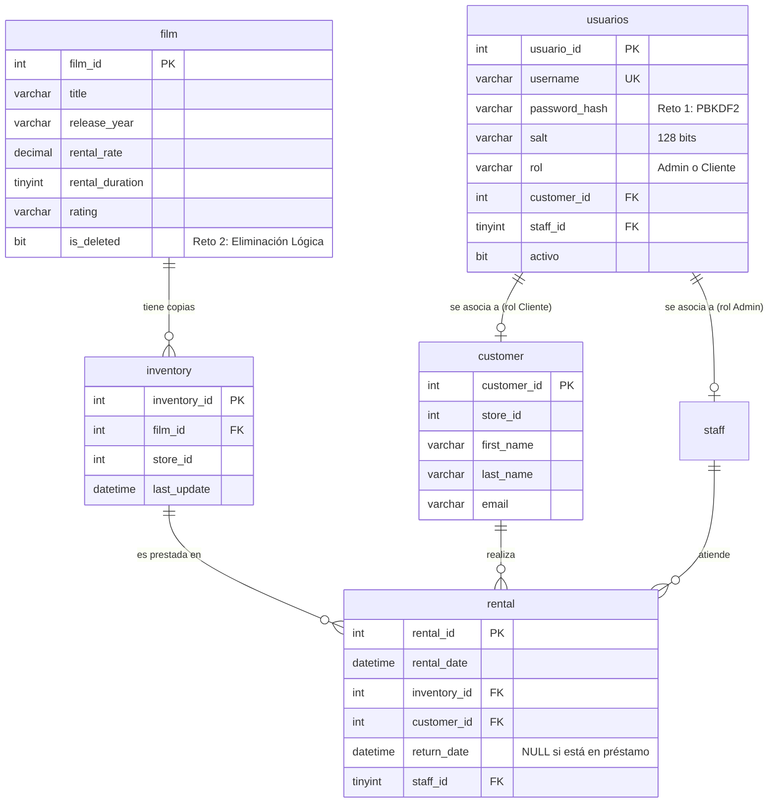
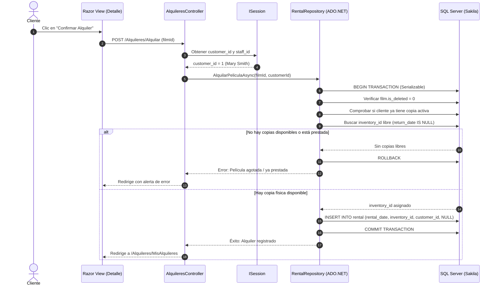

# INFORME TÉCNICO DE PROYECTO - PRIMER PARCIAL

---

# UNIVERSIDAD DE LAS FUERZAS ARMADAS ESPE
**DEPARTAMENTO DE CIENCIAS DE LA COMPUTACIÓN**  
**ASIGNATURA:** Desarrollo Web / Programación de Aplicaciones  
**PERÍODO:** Primer Parcial  

---

### **PROYECTO PRIMER PARCIAL:**
## **MINI SISTEMA DE RENTA DE PELÍCULAS CON SAKILA (ASP.NET CORE MVC & ADO.NET)**

---

**ESTUDIANTE:** Héctor Robles  
**DOCENTE:** Ing. Docente Asignado  
**NRC:** [Colocar aquí tu NRC]  
**FECHA:** Noviembre 2026  

---

### **ENLACES PÚBLICOS DE ENTREGA:**

* **Repositorio Público de GitHub:**  
  https://github.com/Robles-Hector/ProyectoP1-DesarrolloWeb.git  

* **Video Demostrativo Público (Google Drive):**  
  https://drive.google.com/drive/folders/1ak2qsicBZt0wpaMFwvMzMeVrr6upW6ZA?usp=sharing  

---
\pagebreak

## 1. Introducción

El desarrollo de aplicaciones empresariales contemporáneas demanda no solo la presentación visual de datos, sino la articulación rigurosa de principios de arquitectura de software, concurrencia, seguridad criptográfica y preservación de la integridad referencial en bases de datos relacionales. En el contexto de los sistemas transaccionales, el patrón arquitectónico Modelo-Vista-Controlador (MVC) junto con el entorno de ejecución ASP.NET Core representa uno de los estándares industriales más robustos y eficientes para desacoplar la interfaz de usuario, la lógica de control y la capa de acceso a datos.

El presente proyecto implementa un Mini Sistema de Renta de Películas sobre la base de datos relacional Sakila, adaptada para Microsoft SQL Server. A diferencia de las aproximaciones basadas exclusivamente en operaciones elementales de tipo CRUD (Create, Read, Update, Delete) o en generadores automáticos mediante mapeadores objeto-relacional (ORM), este sistema fue construido utilizando acceso a datos de bajo nivel mediante ADO.NET puro (`Microsoft.Data.SqlClient`). Esta decisión técnica permite un control absoluto sobre el texto de las instrucciones Transact-SQL, el aislamiento transaccional y la prevención rigurosa de vulnerabilidades de inyección SQL mediante parametrización estricta.

Asimismo, la solución aborda requerimientos avanzados de negocio: gestión de disponibilidad física en tiempo real sin desnormalizaciones artificiales, un modelo de control de acceso basado en roles (RBAC) gestionado a través de sesiones en servidor (`ISession`) y filtros de autorización personalizados (`ActionFilterAttribute`), el almacenamiento protegido de credenciales mediante el estándar criptográfico PBKDF2 con sal aleatoria de 128 bits, y la aplicación de eliminación lógica (*Soft Delete*) sobre la entidad `film` para salvaguardar el valor analítico y contable del histórico de transacciones. El presente informe técnico detalla la fundamentación teórica, el modelado arquitectónico, la persistencia, las evidencias de ejecución y el análisis reflexivo de cada una de las decisiones de diseño adoptadas.

---

## 2. Objetivos

### Objetivo General:
Desarrollar un sistema web transaccional integral de renta de películas bajo el patrón arquitectónico ASP.NET Core MVC y ADO.NET, conectado a SQL Server sobre la base de datos Sakila, implementando reglas de negocio para disponibilidad física e inventario, gestión de sesiones, seguridad criptográfica con contraseñas protegidas y un mecanismo de eliminación lógica justificado.

### Objetivos Específicos:
* Diseñar e implementar una capa de persistencia en ADO.NET puro mediante `Microsoft.Data.SqlClient`, empleando exclusivamente consultas e instrucciones Transact-SQL parametrizadas y control de transacciones ACID con aislamiento serializable.
* Implementar un flujo completo de autenticación y autorización basado en roles (Administrador y Cliente), interceptando accesos no autorizados mediante filtros de acción (`AuthorizeRoleAttribute`) y preservando la identidad del cliente mediante variables de sesión en memoria (`ISession`).
* Modelar la disponibilidad dinámica de películas en tiempo real a partir de la relación relacional `film` $\to$ `inventory` $\to$ `rental` $\to$ `customer`, garantizando que ninguna película pueda ser alquilada si sus copias físicas registran préstamos activos pendientes de devolución.
* Resolver los retos técnicos obligatorios: protección criptográfica de contraseñas mediante derivación de claves con PBKDF2 (HMAC-SHA256 y sal de 128 bits) y la implementación de eliminación lógica sobre la tabla `film` justificando la conservación de integridad referencial.
* Desarrollar un módulo de reporte analítico de alto rendimiento que consolide el Top 10 de películas con mayor demanda histórica mediante operadores de agregación, agrupamiento y ordenamiento en SQL Server.

---

## 3. Marco Teórico

### 3.1 Patrón Arquitectónico Modelo-Vista-Controlador (MVC) en ASP.NET Core
El patrón arquitectónico MVC desacopla las responsabilidades de una aplicación interactiva en tres componentes fundamentales:
1. **Modelo (Model):** Encapsula el estado de la aplicación, las entidades de dominio (`Film`, `Rental`, `Usuario`) y los objetos de transferencia de datos con validaciones semánticas (`ViewModels`), apoyándose en anotaciones de datos (`DataAnnotations`) que determinan los criterios de aceptación antes de interactuar con la base de datos.
2. **Vista (View):** Representa la interfaz visual generada en el servidor mediante el motor de plantillas Razor (`.cshtml`), el cual combina marcado HTML5 estándar, diseño responsivo a través de Bootstrap 5 y sintaxis C# para proyectar información tipada. Las vistas parciales (`Partial Views`) permiten la reutilización modular de componentes como alertas y barras de navegación.
3. **Controlador (Controller):** Actúa como el orquestador del flujo de trabajo; recibe las peticiones HTTP entrantes, valida el estado del modelo (`ModelState.IsValid`), delega operaciones hacia la capa de repositorio y selecciona la vista o redirección HTTP pertinente.

### 3.2 Acceso a Datos mediante ADO.NET vs. Mapeadores Objeto-Relacional (ORM)
ADO.NET constituye el conjunto de clases fundamentales de .NET para la comunicación directa y conectada con motores de bases de datos relacionales:
* A diferencia de los ORM pesados (como Entity Framework Core), ADO.NET no incurre en sobrecostos (*overhead*) de seguimiento de entidades (*change tracking*), metaprogramación en tiempo de ejecución o abstracciones de traducción de consultas complejas.
* A través de `SqlConnection`, `SqlCommand`, `SqlParameter` y `SqlDataReader`, el desarrollador conserva control milimétrico sobre los planes de ejecución, los tipos de datos en el motor (`SqlDbType`) y el momento exacto de apertura y cierre de recursos.
* **Seguridad y Parametrización:** ADO.NET neutraliza los ataques de inyección SQL (SQLi) al tratar los valores suministrados por el usuario como literales de datos aislados del árbol de análisis sintáctico de Transact-SQL, sin requerir concatenación de cadenas.

### 3.3 Transacciones ACID y Niveles de Aislamiento en SQL Server
En un sistema de alquiler concurrente donde múltiples usuarios pueden solicitar simultáneamente la misma copia física de una película, la atomicidad y el aislamiento transaccional resultan indispensables:
* Las propiedades ACID (Atomicidad, Consistencia, Aislamiento y Durabilidad) garantizan que un conjunto de operaciones concurrentes se ejecute como una unidad indivisible.
* El nivel de aislamiento **Serializable** (`IsolationLevel.Serializable`), implementado junto con bloqueos de actualización y fila (`UPDLOCK, ROWLOCK`), previene fenómenos de lectura fantasma y condiciones de carrera (*Race Conditions*), garantizando que dos clientes no puedan adjudicarse la misma copia física de inventario en el mismo milisegundo.

### 3.4 Seguridad Criptográfica de Contraseñas: PBKDF2 frente a Funciones de Hash Simples
El almacenamiento de credenciales en bases de datos empresariales exige protección contra filtraciones y ataques de diccionario o tablas arcoíris (*Rainbow Tables*):
* Funciones criptográficas rápidas como MD5 o SHA-1 están obsoletas debido a vulnerabilidades de colisión y su excesiva velocidad de cálculo en hardware moderno (GPUs/ASICs), lo que facilita ataques de fuerza bruta.
* El estándar **PBKDF2** (*Password-Based Key Derivation Function 2*, RFC 2898) aplica una función pseudoaleatoria (en este proyecto, **HMAC-SHA256**) de forma iterativa (100,000 ciclos) combinada con una **sal criptográfica (Salt)** aleatoria de 128 bits generada por `RandomNumberGenerator`.
* La presencia de la sal asegura que dos usuarios con la misma contraseña posean hashes completamente distintos, mientras que el factor de trabajo configurable (*work factor*) ralentiza los intentos masivos de descifrado automatizado.

### 3.5 Gestión de Sesión (Session State) y Filtros de Autorización (Action Filters)
El protocolo HTTP es por diseño sin estado (*stateless*). Para aplicaciones con flujos autenticados, ASP.NET Core proporciona el middleware de sesión en memoria:
* Mediante una cookie segura de identificación de sesión (`.SakilaRental.Session`), el servidor mantiene un diccionario en memoria donde se conservan de forma protegida el identificador del usuario, su nombre completo, su rol asignado y su identificador de cliente Sakila (`customer_id`).
* Los filtros de acción personalizados (`ActionFilterAttribute`) permiten desacoplar la lógica de seguridad transversal. El atributo `[AuthorizeRole]` evalúa la sesión en la etapa `OnActionExecuting`, rechazando de manera no invasiva solicitudes no autorizadas antes de que el controlador ejecute cualquier lógica de negocio.

### 3.6 Eliminación Lógica (Soft Delete) vs. Eliminación Física
La eliminación física (`DELETE FROM tabla`) suprime permanentemente tuplas de la base de datos, lo que en modelos relacionales normalizados provoca errores por violación de restricciones de integridad referencial (`FOREIGN KEY`) o pérdidas irreparables en la trazabilidad de auditoría:
* La **eliminación lógica** consiste en incorporar un indicador de estado booleano (`is_deleted BIT NOT NULL DEFAULT 0`).
* Cuando se desactiva un registro, su visibilidad en el dominio operativo se suspende (`WHERE is_deleted = 0`), pero las dependencias históricas con transacciones previas (alquileres, facturación, estadísticas) se mantienen intactas y auditables, otorgando la capacidad de reactivación instantánea.

---

## 4. Desarrollo y Arquitectura de la Solución

### 4.1 Modelo de Datos Sakila y Relación Fundamental
El núcleo operativo del sistema gira en torno a la jerarquía:
$$\text{film (Película)} \xrightarrow{1:N} \text{inventory (Copias Físicas)} \xrightarrow{1:N} \text{rental (Alquileres)} \xleftarrow{N:1} \text{customer (Cliente)}$$



### 4.2 Flujo Transaccional de Alquiler y Disponibilidad en Tiempo Real
El siguiente diagrama detalla cómo el cliente interactúa con el sistema, verificando la disponibilidad física de las copias sin manipulación manual de identificadores:



---

### 4.3 Exploración Inicial de la Base de Datos Sakila
Antes del desarrollo, se exploró la estructura de Sakila seleccionando 3 de los 10 enunciados oficiales requeridos:

#### Consulta 1 Seleccionada:
**Enunciado:** *"Muestre las 10 películas con mayor cantidad de alquileres, indicando título y número de alquileres."*  
* **Código Transact-SQL:**
  ```sql
  SELECT TOP 10 
      f.film_id, 
      f.title AS pelicula, 
      COUNT(r.rental_id) AS total_alquileres
  FROM film f
  INNER JOIN inventory i ON f.film_id = i.film_id
  INNER JOIN rental r ON i.inventory_id = r.inventory_id
  GROUP BY f.film_id, f.title
  ORDER BY total_alquileres DESC;
  ```
* **Formato de Figura para el documento:**
  > **Figura N°1**  
  > **Top 10 películas con mayor cantidad de alquileres en Sakila**  
  > *[ESPACIO PARA PEGAR CAPTURA: Ejecuta la consulta anterior en SSMS y pega la captura de la cuadrícula de resultados con las 10 filas obtenidas]*  
  > La Figura N°1 demuestra la ejecución de la consulta de agregación sobre las tablas `film`, `inventory` y `rental`, evidenciando que el título con mayor demanda histórica en el videoclub es *"BUCKET BROTHERHOOD"* con un total de 34 alquileres registrados, seguido de *"ROCKETEER MOTHER"* con 33 alquileres.

---

#### Consulta 2 Seleccionada:
**Enunciado:** *"Muestre los 5 clientes que hayan realizado más alquileres, indicando nombre completo y cantidad total."*  
* **Código Transact-SQL:**
  ```sql
  SELECT TOP 5 
      c.customer_id, 
      CONCAT(c.first_name, ' ', c.last_name) AS nombre_completo,
      c.email,
      COUNT(r.rental_id) AS total_alquileres
  FROM customer c
  INNER JOIN rental r ON c.customer_id = r.customer_id
  GROUP BY c.customer_id, c.first_name, c.last_name, c.email
  ORDER BY total_alquileres DESC;
  ```
* **Formato de Figura para el documento:**
  > **Figura N°2**  
  > **Top 5 clientes con mayor cantidad de alquileres en Sakila**  
  > *[ESPACIO PARA PEGAR CAPTURA: Ejecuta la consulta anterior en SSMS y pega la captura de la cuadrícula con los 5 clientes]*  
  > Como se observa en la Figura N°2, la consulta concatena los nombres y apellidos de la tabla `customer` y los agrupa para calcular el total de transacciones de alquiler efectuadas. La cliente con mayor recurrencia es ELEANOR HUNT (ID 148) con 46 alquileres, seguida de KARL SEAL con 45 alquileres.

---

#### Consulta 3 Seleccionada:
**Enunciado:** *"Muestre las 10 películas que actualmente tengan al menos una copia disponible para alquilar."*  
* **Código Transact-SQL:**
  ```sql
  SELECT TOP 10 
      f.film_id, 
      f.title AS pelicula, 
      f.rating,
      COUNT(DISTINCT i.inventory_id) AS copias_disponibles
  FROM film f
  INNER JOIN inventory i ON f.film_id = i.film_id
  WHERE i.inventory_id NOT IN (
      SELECT r.inventory_id 
      FROM rental r 
      WHERE r.return_date IS NULL
  )
  GROUP BY f.film_id, f.title, f.rating
  ORDER BY f.title ASC;
  ```
* **Formato de Figura para el documento:**
  > **Figura N°3**  
  > **Películas con copias físicas actualmente disponibles para alquilar**  
  > *[ESPACIO PARA PEGAR CAPTURA: Ejecuta la consulta anterior en SSMS y pega la captura del resultado]*  
  > La Figura N°3 evidencia el cálculo dinámico de disponibilidad física excluyendo de forma rigurosa mediante subconsulta aquellas copias de `inventory` que se encuentran en préstamo activo (`return_date IS NULL`). Títulos como *"ACADEMY DINOSAUR"* registran 7 copias inmediatamente disponibles para renta.

---

## 5. Preguntas de Reflexión

### Pregunta 1: ¿Qué diferencia existe entre autenticación, autorización y Session dentro de su proyecto? Explique cómo interviene cada concepto desde que un usuario inicia sesión hasta que intenta ejecutar una operación restringida.
* **Respuesta Técnica:**
  - **Autenticación:** Es el proceso de verificar fehacientemente la identidad declarada por el usuario. En el proyecto ocurre en `AccountController.Login`: el usuario ingresa su nombre de usuario y contraseña; `UsuarioRepository.ValidarLoginAsync` recupera el registro de la tabla `usuarios` y evalúa el hash criptográfico PBKDF2 junto con la sal almacenada utilizando `PasswordHelper.VerifyPassword`. Si coinciden, la identidad es confirmada.
  - **Session:** Es el mecanismo de estado en el servidor (`ISession`) que enlaza de manera persistente los datos contextuales del usuario autenticado durante su navegación sin exponerlos en el cliente. Inmediatamente después del login exitoso, el sistema almacena `UsuarioId`, `Username`, `Rol` ('Administrador' o 'Cliente') y el identificador asociado (`CustomerId` o `StaffId`).
  - **Autorización:** Es la determinación de si la identidad autenticada posee los privilegios requeridos para ejecutar una acción específica. Se implementó en el filtro `AuthorizeRoleAttribute`.
  - **Intervención en secuencia:** Cuando un usuario autenticado como 'Cliente' intenta escribir en su navegador la URL `/AdminPeliculas`, el pipeline de ASP.NET Core invoca `AuthorizeRoleAttribute.OnActionExecuting`. El filtro examina la variable de **Session** `Rol`; al constatar que el valor es 'Cliente' y la acción exige 'Administrador', el filtro **aborta la ejecución del controlador** y redirige al usuario a `/Account/AccessDenied` con un error 403, impidiendo cualquier operación no permitida.

### Pregunta 2: En Sakila, ¿por qué la disponibilidad de una película no debería representarse simplemente agregando un campo Stock en la tabla film? Explique la participación de film, inventory y rental.
* **Respuesta Técnica:**
  Representar la disponibilidad como un atributo numérico estático `Stock` en la tabla `film` constituiría un grave error de diseño relacional y desnormalización por las siguientes razones:
  1. **Naturaleza física individual:** Una película no es un producto consumible abstracto, sino una obra intelectual materializada en unidades físicas concretas (discos DVD/Blu-ray). Cada copia física existe como una tupla individualizada en `inventory` (`inventory_id`) y pertenece a una sucursal específica (`store_id`).
  2. **Trazabilidad histórica:** Cada préstamo en la tabla `rental` no se asocia genéricamente a la película, sino a un `inventory_id` específico. Esto permite conocer qué copia física particular tiene desgastes, cuál está en la Tienda 1 o Tienda 2, y quién la tiene en su poder.
  3. **Inconsistencias y anomalías de actualización:** Si existiera un campo `Stock`, cualquier fallo transaccional durante un alquiler o devolución desincronizaría el contador respecto a la realidad de las copias físicas en estantería. La disponibilidad genuina es un **cálculo derivado en tiempo real**:
  $$\text{Disponibilidad} = \text{COUNT}(i.inventory\_id) - \text{COUNT}(r.rental\_id \text{ WHERE } r.return\_date \text{ IS NULL})$$

### Pregunta 3: ¿Cómo determina su aplicación qué cliente está realizando un alquiler y por qué sería incorrecto permitir que el usuario seleccione manualmente su customer_id desde el formulario?
* **Respuesta Técnica:**
  La aplicación determina la identidad del cliente extrayendo directamente el identificador almacenado en la sesión de navegación del servidor:
  ```csharp
  int? customerId = HttpContext.Session.GetCustomerId();
  ```
  Permitir que el usuario seleccione manualmente su `customer_id` desde una lista desplegable o campo de formulario constituiría una vulnerabilidad crítica de seguridad conocida como **Referencia Directa Insegura a Objetos (IDOR - Insecure Direct Object Reference)** y suplantación de identidad:
  - Cualquier cliente malicioso podría modificar el identificador en el formulario HTML o interceptar la petición HTTP para registrar alquileres a nombre de otro cliente, cargándole cobros fraudulentos o agotando su cupo de préstamos.
  - Al tomar el valor de `Session`, la aplicación garantiza que la operación quede irremediablemente imputada a la cuenta autenticada.

### Pregunta 4: ¿Qué ocurre en su aplicación cuando un cliente intenta alquilar una película cuyas copias se encuentran actualmente alquiladas? Explique la regla de negocio y la consulta o procedimiento utilizado para comprobar la disponibilidad.
* **Respuesta Técnica:**
  Cuando un cliente intenta alquilar una película agotada, la aplicación aplica la **Regla de Negocio de Disponibilidad Física**:
  1. En la vista (`Detalle.cshtml`), el sistema detecta que `CopiasDisponibles == 0`, deshabilita el botón de confirmación y proyecta una alerta visual en color rojo indicando que todas las copias se encuentran en préstamo.
  2. A nivel de persistencia en `RentalRepository.AlquilarPeliculaAsync`, dentro de una transacción con aislamiento `Serializable`, se ejecuta la consulta de búsqueda de copias libres con bloqueo de actualización:
  ```sql
  SELECT TOP 1 i.inventory_id
  FROM inventory i WITH (UPDLOCK, ROWLOCK)
  WHERE i.film_id = @FilmId
    AND i.inventory_id NOT IN (
        SELECT r.inventory_id 
        FROM rental r 
        WHERE r.return_date IS NULL
    )
  ORDER BY i.inventory_id ASC;
  ```
  3. Si la consulta devuelve `NULL`, la transacción se revierte (`tx.RollbackAsync()`) y el repositorio retorna `Success = false` con el mensaje informativo: *"Lo sentimos, todas las copias de esta película se encuentran alquiladas actualmente. Intente más tarde."* Ningún registro en `rental` es insertado.

### Pregunta 5: ¿Qué ventajas aporta la eliminación lógica frente a una eliminación física en la entidad seleccionada? Explique cómo la implementó y qué cambios fueron necesarios en las consultas utilizadas por la aplicación.
* **Respuesta Técnica:**
  - **Ventajas frente a la eliminación física:**  
    En Sakila, la tabla `film` es el nodo raíz de dependencias referenciales en cascada (`film` $\to$ `film_actor`, `film_category`, `inventory` $\to$ `rental` $\to$ `payment`). Un `DELETE FROM film` fallaría inmediatamente por violación de claves foráneas (`FK`), o, de forzarse la eliminación en cascada, destruiría miles de registros de auditoría financiera, pagos pasados y alquileres históricos, falseando los balances del videoclub. La eliminación lógica conserva la integridad histórica del negocio.
  - **Implementación técnica:**  
    Se alteró la tabla agregando la columna `is_deleted BIT NOT NULL DEFAULT 0`. En el controlador administrativo, el método `ToggleSoftDelete` invoca una actualización Transact-SQL que invierte el bit:
    ```sql
    UPDATE film SET is_deleted = CASE WHEN is_deleted = 1 THEN 0 ELSE 1 END, last_update = GETDATE() WHERE film_id = @FilmId;
    ```
  - **Cambios requeridos en las consultas:**  
    En `FilmRepository.GetCatalogoAsync`, se incorporó la cláusula dinámica `WHERE f.is_deleted = 0` para todas las consultas destinadas a clientes y público general, ocultando los títulos inactivos. Para el administrador, se parametrizó la opción `incluirEliminadas`, permitiéndole listar las películas dadas de baja con un distintivo visual (*Inactiva*) y reactivarlas cuando vuelvan a estar disponibles.

---

## 6. Evidencias de Ejecución y Guía de Inclusión de Código

> **INSTRUCCIONES PARA EL ESTUDIANTE:**  
> A continuación se detallan las figuras de evidencia requeridas con el formato exacto solicitado. Toma las capturas de tu pantalla con la aplicación corriendo en `http://localhost:5217` y pégalas en los espacios señalados.  
> Debajo de cada figura, se especifica con total precisión **qué archivo de código abrir**, **qué método copiar** y **dónde pegarlo en tu informe**.

---

### Evidencia 1: Inicio de Sesión y Reto 1 de Contraseña Protegida
* **Figura N°4**  
  **Pantalla de autenticación y verificación de contraseñas protegidas**  
  *[PEGAR AQUÍ CAPTURA DE PANTALLA: Abre `/Account/Login` en el navegador donde se aprecie el formulario y la tarjeta informativa de usuarios y Reto 1]*  
  La Figura N°4 muestra la interfaz de autenticación del sistema, diseñada con Bootstrap 5, en la cual se ingresan las credenciales de los usuarios. Las contraseñas son validadas en el servidor sin exponer texto plano, contrastando el hash derivado con la sal almacenada.

> 📋 **CÓDIGO A COPIAR Y PEGAR EN ESTA SECCIÓN:**  
> **Archivo a abrir:** `SakilaRentalApp/Utils/PasswordHelper.cs`  
> **Fragmento a copiar:** Métodos `HashPassword` y `VerifyPassword` (líneas 16 a 58).  
> **Lugar donde pegarlo:** Justo debajo de la explicación de la Figura N°4 para justificar técnicamente el Reto 1.

---

### Evidencia 2: Navegación Adaptativa según el Rol (Cliente vs. Administrador)
* **Figura N°5**  
  **Barra de navegación adaptada al perfil del Cliente autenticado**  
  *[PEGAR AQUÍ CAPTURA DE PANTALLA: Inicia sesión con `mary.smith` y captura la cabecera/navbar mostrando el badge verde "CLIENTE" y el menú "Mis Alquileres"]*  
  Como se aprecia en la Figura N°5, la barra de navegación reconoce dinámicamente el rol del usuario extraído de la sesión, presentando exclusivamente las opciones operativas para el cliente, tales como el catálogo general y su módulo personal de alquileres.

* **Figura N°6**  
  **Barra de navegación y menú desplegable del perfil Administrador**  
  *[PEGAR AQUÍ CAPTURA DE PANTALLA: Inicia sesión con `admin` y despliega el menú "Administración" con Gestión de Películas y Control de Alquileres]*  
  La Figura N°6 ilustra la interfaz visible únicamente para el rol Administrador, habilitando el menú de gestión de inventario físico, el mantenimiento CRUD del catálogo y el acceso a la auditoría global de alquileres.

> 📋 **CÓDIGO A COPIAR Y PEGAR EN ESTA SECCIÓN:**  
> **Archivo a abrir:** `SakilaRentalApp/Views/Shared/_Navbar.cshtml`  
> **Fragmento a copiar:** Bloque condicional `@if (esCliente)` y `@if (esAdmin)` (líneas 27 a 62).  
> **Lugar donde pegarlo:** Debajo de la Figura N°6 para demostrar la adaptación visual de la interfaz Razor según el rol.

---

### Evidencia 3: Restricción de Autorización (Error 403)
* **Figura N°7**  
  **Bloqueo y pantalla de Acceso Denegado ante intento de acceso manual**  
  *[PEGAR AQUÍ CAPTURA DE PANTALLA: Estando como `mary.smith`, escribe en la URL `/AdminPeliculas` y captura la pantalla de Acceso Denegado 403]*  
  La Figura N°7 demuestra la efectividad de la política de autorización del sistema. Cuando un cliente intenta acceder de forma manual a una URL administrativa, el filtro intercepta la solicitud y proyecta una pantalla restrictiva con código de estado HTTP 403.

> 📋 **CÓDIGO A COPIAR Y PEGAR EN ESTA SECCIÓN:**  
> **Archivo a abrir:** `SakilaRentalApp/Filters/AuthorizeRoleAttribute.cs`  
> **Fragmento a copiar:** Método `OnActionExecuting` completo (líneas 15 a 55).  
> **Lugar donde pegarlo:** Debajo de la Figura N°7 para documentar la implementación del filtro de autorización.

---

### Evidencia 4: Catálogo de Películas y Disponibilidad en Tiempo Real
* **Figura N°8**  
  **Catálogo de películas con indicadores dinámicos de copias físicas disponibles**  
  *[PEGAR AQUÍ CAPTURA DE PANTALLA: Entra a `/Peliculas` mostrando la cuadrícula de tarjetas con los badges verdes de disponibilidad]*  
  La Figura N°8 muestra el catálogo de películas donde cada tarjeta calcula en tiempo real el número de copias físicas presentes en inventario y cuántas de ellas se encuentran libres para alquiler inmediato.

> 📋 **CÓDIGO A COPIAR Y PEGAR EN ESTA SECCIÓN:**  
> **Archivo a abrir:** `SakilaRentalApp/Data/FilmRepository.cs`  
> **Fragmento a copiar:** La consulta Transact-SQL y ejecución en el método `GetCatalogoAsync` (líneas 63 a 125).  
> **Lugar donde pegarlo:** Debajo de la Figura N°8 para evidenciar la consulta ADO.NET parametrizada y la paginación.

---

### Evidencia 5: Detalle de Película y Confirmación de Alquiler
* **Figura N°9**  
  **Vista de detalle con desglose de copias en inventario y acción de alquiler**  
  *[PEGAR AQUÍ CAPTURA DE PANTALLA: Abre el detalle de una película disponible (`/Peliculas/Detalle/1`) mostrando la tabla de copias de inventario y el botón "Confirmar Alquiler"]*  
  En la Figura N°9 se observa la pantalla de detalle donde se desglosan las características del filme, el estado de cada copia en inventario y el panel de alquiler que adjudica la transacción al cliente autenticado en la sesión.

> 📋 **CÓDIGO A COPIAR Y PEGAR EN ESTA SECCIÓN:**  
> **Archivo a abrir:** `SakilaRentalApp/Data/RentalRepository.cs`  
> **Fragmento a copiar:** Método `AlquilarPeliculaAsync` (líneas 20 a 115).  
> **Lugar donde pegarlo:** Debajo de la Figura N°9 para demostrar el manejo de la transacción atómica serializable y la asignación de inventario.

---

### Evidencia 6: Módulo "Mis Alquileres" y Registro de Devolución
* **Figura N°10**  
  **Listado personal de préstamos en el módulo Mis Alquileres**  
  *[PEGAR AQUÍ CAPTURA DE PANTALLA: Abre `/Alquileres/MisAlquileres` mostrando el alquiler recién realizado con el badge "En tu poder"]*  
  La Figura N°10 muestra el historial exclusivo de préstamos de la cliente Mary Smith, identificando la película alquilada, la fecha del préstamo y el botón interactivo para procesar la devolución.

* **Figura N°11**  
  **Actualización de estado a Devuelto tras registrar la entrega**  
  *[PEGAR AQUÍ CAPTURA DE PANTALLA: Pulsa "Devolver Película" y captura la tabla mostrando el estado "Devuelto" en verde con la fecha/hora actual]*  
  Como se observa en la Figura N°11, al registrar la devolución el estado cambia inmediatamente a devuelto, sellando la fecha y hora de entrega sin eliminar el registro histórico de la base de datos.

> 📋 **CÓDIGO A COPIAR Y PEGAR EN ESTA SECCIÓN:**  
> **Archivo a abrir:** `SakilaRentalApp/Data/RentalRepository.cs`  
> **Fragmento a copiar:** Método `DevolverPeliculaAsync` (líneas 120 a 180).  
> **Lugar donde pegarlo:** Debajo de la Figura N°11 para sustentar las reglas de validación de propiedad y estado del alquiler.

---

### Evidencia 7: Panel Administrativo CRUD y Reto 2 de Eliminación Lógica
* **Figura N°12**  
  **Gestión administrativa de películas y estado de eliminación lógica**  
  *[PEGAR AQUÍ CAPTURA DE PANTALLA: En `/AdminPeliculas`, pulsa el botón rojo de eliminación lógica sobre una película y captura la fila mostrando el badge rojo "Inactiva"]*  
  La Figura N°12 exhibe la administración de películas donde se aplicó el Reto Técnico 2 de eliminación lógica. La película desactivada permanece en la base de datos pero deja de ser visible para los clientes en el catálogo público.

* **Figura N°13**  
  **Reactivación de la película previamente eliminada de forma lógica**  
  *[PEGAR AQUÍ CAPTURA DE PANTALLA: Marca la casilla "Mostrar películas eliminadas lógicamente" y captura el botón verde de reactivación]*  
  En la Figura N°13 se evidencia la capacidad del administrador para visualizar los títulos dados de baja y reactivarlos inmediatamente con un solo clic mediante la inversión del campo booleano `is_deleted`.

> 📋 **CÓDIGO A COPIAR Y PEGAR EN ESTA SECCIÓN:**  
> **Archivo a abrir:** `SakilaRentalApp/Data/FilmRepository.cs`  
> **Fragmento a copiar:** Método `ToggleSoftDeleteAsync` (líneas 280 a 297).  
> **Lugar donde pegarlo:** Debajo de la Figura N°13 para justificar el código SQL de alternancia del estado lógico.

---

### Evidencia 8: Reporte de Películas Más Alquiladas
* **Figura N°14**  
  **Reporte Top 10 de películas con mayor cantidad histórica de alquileres**  
  *[PEGAR AQUÍ CAPTURA DE PANTALLA: Abre `/Reportes/PeliculasMasAlquiladas` mostrando la tabla con el puesto 1 BUCKET BROTHERHOOD (34 alquileres) y el cuadro del código SQL]*  
  La Figura N°14 presenta el módulo de reporte estadístico solicitado en el proyecto, ejecutado a través de ADO.NET con operadores de agregación, proyectando las 10 películas más demandadas del videoclub junto con su disponibilidad en inventario.

> 📋 **CÓDIGO A COPIAR Y PEGAR EN ESTA SECCIÓN:**  
> **Archivo a abrir:** `SakilaRentalApp/Data/ReporteRepository.cs`  
> **Fragmento a copiar:** Método `GetPeliculasMasAlquiladasAsync` completo (líneas 18 a 56).  
> **Lugar donde pegarlo:** Debajo de la Figura N°14 para documentar la consulta de agregación con `INNER JOIN`, `GROUP BY`, `COUNT` y `TOP`.

---

## 7. Conclusiones

* La implementación del patrón arquitectónico ASP.NET Core MVC con ADO.NET puro demostró ser una solución de alta eficiencia y transparencia para sistemas transaccionales, eliminando la sobrecarga computacional de los ORM pesados y permitiendo un control riguroso sobre las consultas Transact-SQL y los tipos de datos en SQL Server.
* El cálculo dinámico de disponibilidad física a partir de la relación $\text{film} \to \text{inventory} \to \text{rental}$ evitó anomalías de concurrencia y desnormalizaciones artificiales, asegurando que el estado operativo de cada copia física refleje con exactitud matemática los alquileres sin devolución (`return_date IS NULL`).
* La gestión de sesiones mediante `ISession` combinada con filtros de acción desacoplados (`AuthorizeRoleAttribute`) garantizó un esquema de seguridad perimetral robusto que impide la vulnerabilidad IDOR y el acceso a rutas administrativas mediante manipulación directa de URLs.
* El Reto Técnico 1 confirmó la superioridad del estándar criptográfico PBKDF2 con HMAC-SHA256 y sal aleatoria de 128 bits frente a esquemas de hash simples, neutralizando ataques de diccionario y tablas arcoíris al impedir que las contraseñas se almacenen en texto claro.
* El Reto Técnico 2 demostró que la eliminación lógica sobre la entidad `film` es la estrategia idónea para sistemas empresariales complejos, ya que resguarda la integridad referencial y preserva el valor analítico y contable del histórico de alquileres para fines de reportería y auditoría.

---

## 8. Recomendaciones

* **Implementación de Caché Distribuido:** Para entornos de producción con alta concurrencia, se recomienda migrar el almacenamiento de sesiones en memoria local (`AddDistributedMemoryCache`) hacia un clúster distribuido en Redis, garantizando persistencia y balanceo de carga entre múltiples instancias web.
* **Transiciones de Estado Físico:** Se sugiere enriquecer la entidad `inventory` incorporando estados de mantenimiento físico (ej. *Copia en Reparación*, *Copia Extraviada*), ampliando la regla de negocio para que solo copias con estado *Óptimo* sean elegibles para renta.
* **Índices Filtrados en SQL Server:** Para optimizar las consultas de disponibilidad y el reporte analítico en bases de datos con millones de tuplas, se aconseja crear un índice no agrupado filtrado en SQL Server sobre la tabla `rental` para la condición `WHERE return_date IS NULL`.
* **Políticas de Renovación de Alquiler:** Sería beneficioso implementar una funcionalidad de renovación anticipada que calcule recargos o moras automáticas si el cliente supera los días estipulados en `rental_duration`.
* **Autenticación en Dos Factores (2FA):** Como evolución del módulo de seguridad, se recomienda incorporar autenticación multifactor mediante códigos TOTP temporales para las cuentas con privilegios administrativos.

---

## 9. Bibliografía

* Freeman, A. (2022). *Pro ASP.NET Core 6: Develop Cloud-Ready Web Applications Using MVC, Blazor, and Razor Pages* (9th ed.). Apress.
* Microsoft Corporation. (2026). *ASP.NET Core MVC Overview and Architectural Best Practices*. Microsoft Learn Documentation. https://learn.microsoft.com/aspnet/core/mvc/overview
* Microsoft Corporation. (2026). *Microsoft.Data.SqlClient Namespace & ADO.NET Architecture Guide*. Microsoft Learn Documentation. https://learn.microsoft.com/sql/connect/ado-net/introduction-microsoft-data-sqlclient-namespace
* National Institute of Standards and Technology (NIST). (2023). *Digital Identity Guidelines: Authentication and Lifecycle Management* (Special Publication 800-63B). U.S. Department of Commerce.
* OWASP Foundation. (2025). *OWASP Top 10 Web Application Security Risks: A01 Broken Access Control & A03 Injection*. Open Worldwide Application Security Project. https://owasp.org/Top10/
* Ben-Gan, I. (2020). *T-SQL Fundamentals* (3rd ed.). Microsoft Press.

---

## 10. Anexos

### Anexo A: Script de Eliminación Lógica sobre Film (`01_alter_sakila_film_softdelete.sql`)
```sql
USE sakila;
GO

IF NOT EXISTS (
    SELECT 1 FROM INFORMATION_SCHEMA.COLUMNS 
    WHERE TABLE_NAME = 'film' AND COLUMN_NAME = 'is_deleted'
)
BEGIN
    ALTER TABLE film ADD is_deleted BIT NOT NULL CONSTRAINT DF_film_is_deleted DEFAULT 0;
    PRINT 'Columna is_deleted agregada exitosamente a la tabla film.';
END
GO
```

### Anexo B: Script de Creación de Tabla Usuarios (`02_create_usuarios_table.sql`)
```sql
USE sakila;
GO

IF NOT EXISTS (
    SELECT 1 FROM INFORMATION_SCHEMA.TABLES 
    WHERE TABLE_NAME = 'usuarios'
)
BEGIN
    CREATE TABLE usuarios (
        usuario_id INT IDENTITY(1,1) PRIMARY KEY,
        username VARCHAR(50) NOT NULL UNIQUE,
        password_hash VARCHAR(256) NOT NULL,
        salt VARCHAR(256) NOT NULL,
        rol VARCHAR(20) NOT NULL,
        nombre_completo VARCHAR(100) NOT NULL,
        email VARCHAR(100) NULL,
        customer_id INT NULL,
        staff_id TINYINT NULL,
        activo BIT NOT NULL DEFAULT 1,
        fecha_creacion DATETIME NOT NULL DEFAULT GETDATE(),
        CONSTRAINT FK_usuarios_customer FOREIGN KEY (customer_id) REFERENCES customer(customer_id),
        CONSTRAINT FK_usuarios_staff FOREIGN KEY (staff_id) REFERENCES staff(staff_id)
    );
END
GO
```
